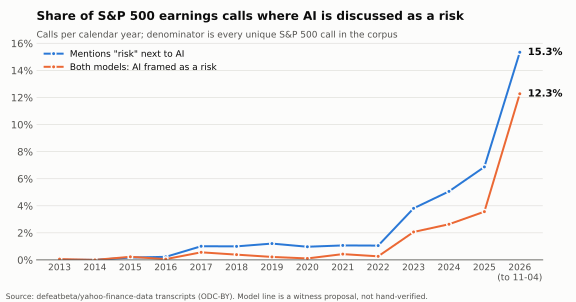
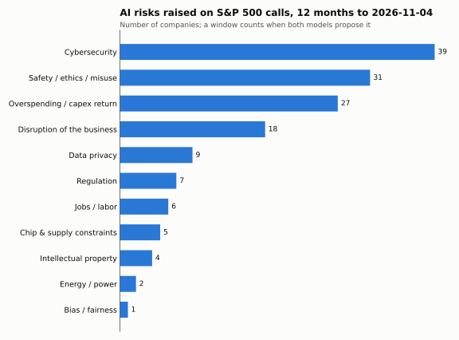
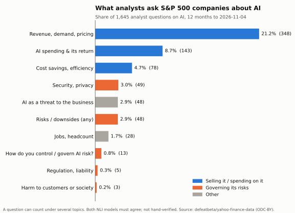
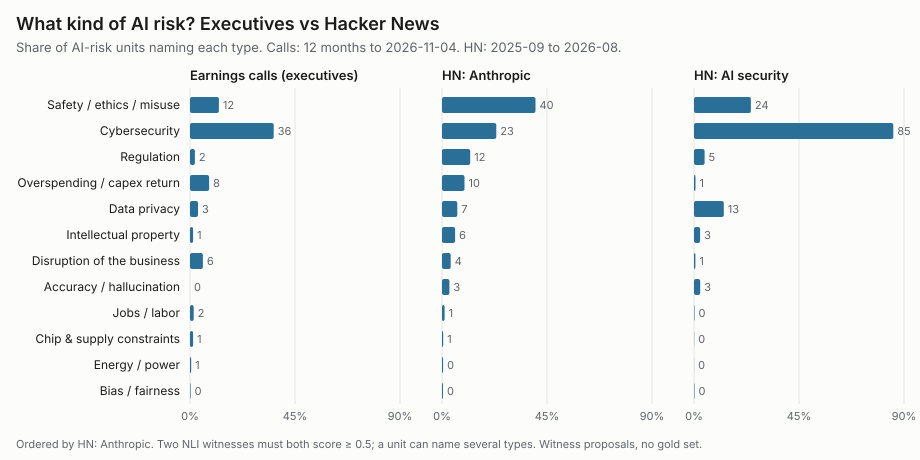
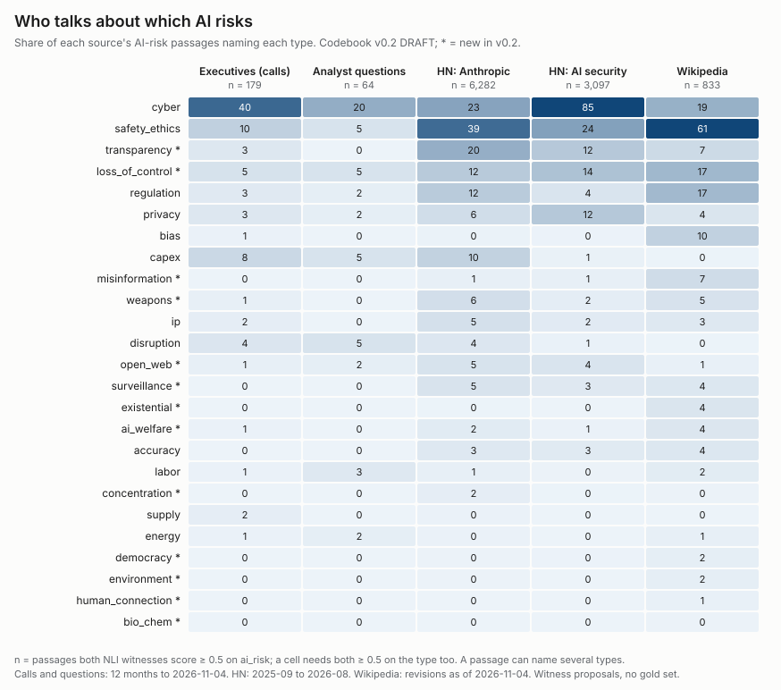
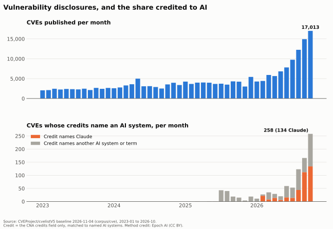

<!-- Built from committed files only. Charts: docs/figures/build.py (the paper's own),
     the corpus report scripts under scripts/, and scripts/deck_charts.py.
     Render: npx @marp-team/marp-cli@3.4.0 DECK.md --pptx  (or --pdf, --html) -->

# Anthropic PBC
## A counterpoint to the 2026 Public Benefit Report, in charts

Working paper v0: "released for disagreement, not as a verdict."
Paper: `docs/anthropic-contrapunctus.md`. Every chart here rebuilds from committed files.

Model output in these charts comes from witnesses: two NLI models whose labels are proposals, not hand-verified findings.

---

## The argument in one line

**Anthropic's charter is legally real and legally toothless.**

- §365(b) gives directors no duty to any person on account of a public-benefit interest.
- §367 limits enforcement to holders of ≥2% (or $2M, lesser, once listed).
- The public the charter names cannot enforce it.

The Report argues from *inputs + intentions* to a discharged public duty. The paper finds that inference unearned (§3).

---

<!-- _class: chart -->

51 of 60 load-bearing quotes verified byte-exact against the PBC Report and S-1 (loop audit, 2026-11-03). "129,000" is not in the Report.

---

<!-- _class: chart -->

Appendix A: 0 of 10 governance dimensions held as filed; 4 partial or revocable, 6 absent.

---

<!-- _class: chart -->

§1a, Meadows leverage points: Anthropic acts at 12 and 6, declines at 5, 4 and 3, speaks at 2 and 3.

---

<!-- _class: chart -->

Risk–Governance Index v1 on Anthropic's own disclosed risks: 0 of 8 controlled.

---

# What the public record shows

The paper's evidence is Anthropic's own filings. The rest of this deck looks outward at what public data says about AI risk and Anthropic:

- **S&P 500 earnings calls:** what companies and analysts say about AI.
- **Hacker News:** what practitioners say about Anthropic and AI security.
- **Wikipedia:** the map of AI-risk ideas.
- **The CVE record:** what the vulnerability database credits to AI.

---

<!-- _class: chart -->

AI as a risk on S&P 500 calls: 12.3% of 2026 calls (to 11-04) by both models, up from under 1% before 2023.

---

<!-- _class: chart -->

Companies name cybersecurity, safety and overspending. Energy, bias and jobs barely register. Codebook v0.1.

---

<!-- _class: chart -->

Analysts ask how AI sells (21.2% of AI questions) far more than how it is governed (0.8%). This bears on App. E: almost nobody on a call asks about control.

---

<!-- _class: chart -->

Hacker News discussion of Anthropic is about safety and ethics (40%) far more than executives' calls are (12%). Codebook v0.1; HN precision on safety/ethics is weaker (method doc).

---

<!-- _class: chart -->

The dialogue space, under the DRAFT v0.2 codebook: executives and analysts talk about cyber and capex; Wikipedia covers the field. Draft wording; shares differ from v0.1.

---

<!-- _class: chart -->

The public CVE record credits Claude on 370 CVEs (2020-01 to 2026-10) and any AI system on 924. That cannot confirm or refute "33,000+": not every flaw becomes a CVE, and credits need not name the tool.

---

## What this deck does not show

- **No effect of Anthropic on any outcome.** Attention and counts only.
- **No gold set yet.** Every model-labelled chart is a two-witness proposal; precision is unmeasured.
- **Survivorship.** The earnings-call universe is today's S&P 500.
- **No news-attention chart.** GDELT's daily series drops days (18 of 31 in October 2026), so it was left out.
- **The paper is unsealed.** The sealed version will carry its graph-root hash.

Sources, licences and rebuild commands: `DATASETS.md` and each corpus's method doc.
