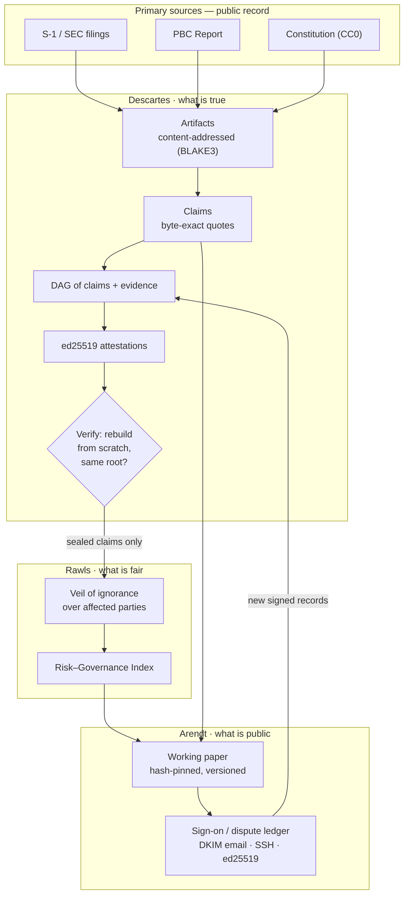

# Anthropic PBC

### A cryptographically verifiable counterpoint to Anthropic's 2026 Public Benefit Report

> Governance exists so that systems can survive individuals.

**Now:** the argument is being rebuilt as checkable cards, live at [srvo.github.io/anthropic-pbc](https://srvo.github.io/anthropic-pbc/). See [where the argument stands](#where-the-argument-stands).

I'm publishing this in a personal capacity, to show a set of composable
governance primitives I've built over the past year as Chief Investment Officer
at Ethical Capital, a Utah-registered investment adviser. So this is governance
advice, not investment advice; I hold no direct or indirect position in
Anthropic, and our screening, our process, and our timestamped analysis of most
large public companies — the hyperscalers included — are public at ethicic.com.
A disclosure like that has never satisfied the duty of care I actually feel I
owe my regulators, my clients, and my community. It leaves the one question that
matters unanswered: **am I in control of the systems I use to make decisions,
operate, and balance competing priorities?** You should ask it of anyone — me,
and Anthropic.

For a long-term investor it isn't optional. Returns materialize over decades, so
we have to back systems of activity that can survive the loss of any one person;
and because our ethical criteria are stringent, I care less about correlation
than about intrinsic alignment — is the thing built, at its core, to do what it
says? That is exactly what a public benefit corporation is supposed to be. Good
governance is the kind you can recognize from the outside: you can see how a
company organizes its operations, and the mindset and values the whole system
springs from. That is the highest of Donella Meadows' places to intervene in a
system, and the one almost no one moves.

Here is a public benefit corporation I'm directly involved in:
[Wood Cache](https://www.woodcache.org). You can understand what it does from the
website in a minute. The fastest-growing carbon pool in the Mountain West is dead
trees; they burn, and when they burn they throw off the most dangerous air
pollution there is. Wood Cache buries that biomass and locks the carbon away
instead — measured and verified end to end under
[Puro.earth's terrestrial-storage methodology](https://puro.earth/methodologies/terrestrial-storage-of-biomass/),
with the burial sites themselves permitted and regulated by the State of Colorado
as landfills. Sit with the disparity: this is a small, directly observable,
present public benefit, and the scrutiny on it is immense — while the worst case
is that carbon which would have burned anyway instead sits underground and breaks
down over a shorter horizon than the academic models predict. The inputs are
certain, controlled, and governed; the open questions are mostly market demand
and economics. That is what a real public benefit looks like, and it is the
opposite of the sexy move — a convoluted machine that turns carbon into money
through some bleeding-edge, multi-gigawatt feat of engineering, with the benefit
arriving, supposedly, later. Accumulate power, pour in capital, trust that impact
shows up someday: that is the model our culture has learned to call "impact," and
I don't accept it.

The public-benefit-corporation category is about to balloon when Anthropic lists,
so it matters, now, to have a way to check whether a benefit claim is actually
backed by the evidence offered for it. That is what I built. I call it Praxis,
and I named its parts after philosophers so their jobs are legible: **Descartes**
verifies the smallest facts it can, with no external input, and signs them; those
facts accrete into entities and relationships; **Rawls** runs them through a veil
of ignorance — would you accept this system if you didn't get to choose who you'd
be inside it? The report below came together largely that way, deterministically,
with light editorial shaping. It already caught one of my own errors, which is
the method working, not failing.

Anthropic fails that test in a specific way. The harm is distributed; there is no
visible feedback loop between the people it lands on now and the people deciding;
and the structure is a race to be first, in which you cannot help but lose control
of your effect on others. Set that against Wood Cache: a small, observable benefit
submits to immense scrutiny, while Anthropic proposes to expose the world to
genuinely serious risks and — rather than cede control of that exposure, even to
the users already paying for the compute — insists on holding it itself. It treats
impact the way finance treats money, too: deploy the capital today, clear your
return in a decade. But impact is not a single currency, and there is no
reconciliation unless a governance forces one. What follows takes Anthropic at its
own word — against its own filings and its own Constitution — and checks, byte by
byte, where the words and the acts diverge.

---

## Where the argument stands

The v0 paper below is a fixed record. I'm rebuilding its argument so anyone can check it step by step and see where it holds and where it breaks. The rebuild becomes the next edition.

**Live views** (rebuilt and redeployed on every release to `main`):
- [Workbench](https://srvo.github.io/anthropic-pbc/): the complaint sphere, every chain, the barriers, the carried-forward numbers and the survival scenarios.
- [Chain view](https://srvo.github.io/anthropic-pbc/chain/): each argument as a sequence of *therefore*, *but* and *and then* links, with the proposed chain beside the proven one.
- [Card deck](https://srvo.github.io/anthropic-pbc/cards/): every card by theme, with its quotes.

### How it is built

- **Cards.** Each step is a card holding one short claim and naming what it rests on: a quote checked byte for byte against a primary source, another card, or a source not yet pinned. Cards live in [`argument/`](argument/). The prose draft, [`argument/paper.from-cards.md`](argument/paper.from-cards.md), is generated from them and never edited by hand.
- **Circles.** A card is proven (circle 1) only when every quote beneath it passes Descartes' byte check. A failing quote or a missing source leaves it at circle 0, and it stays in the deck, marked unproven. Circle 4 is the author's sign-off, and no card has it yet.
- **Links.** Each step follows from the one before (*therefore*), turns against it (*but*), or sits beside it (*and then*). A run of *and then* is a list, not an argument. The links are computed from what each card rests on, never typed in.
- **Standing and coverage.** The workbench maps who can make Anthropic keep its promise and who bears the effects, and whether the argument has heard from each of them directly, secondhand, by name only, or not at all.
- **Quantities.** Every number is *observed* (it appears in a checked quote), *applied* (an assumption you set on the page, labelled unsourced), or *implied* (a formula over the others).
- **Lenses.** Some questions get several answers side by side. "Can the planet tolerate this buildout?" has five:
  - planetary boundaries, which yields a budget once you choose how to share it;
  - the remaining carbon budget;
  - the doughnut;
  - the local water basin;
  - an opposing energy-abundance view.

### Snapshot at commit d2c46b7

- **Cards:** 115 cards, of which 42 are proven.
- **Links:** of 103 links, 20 are *therefore*, and only 4 of those are proven. 42 are *and then*.
- **The conclusion is not yet proven.** "Anthropic is a public benefit corporation in law, not in the sense the category promises" waits on 15 sources.
- **Standing:** 17 parties are mapped, and 2 have standing the cards prove.
- **Coverage:** no affected party is heard directly.

The live workbench always shows the current figures.

### How to help

The workbench ranks every barrier by how much of the argument fixing it would prove. The top three:
1. **Pin Bjørn et al. 2020.** It sets out the ways to share a planetary budget. The publisher's PDF embeds the downloader's IP address, so the copy can't be reproduced.
2. **Repair quote Q050.**
3. **Pin the Wood Cache source.**

Open an issue or a pull request against `argument/` with a pinned source or a corrected quote. To dispute a claim, use [`docs/contrapunctus-attest.md`](docs/contrapunctus-attest.md).

### Rules

- No invented numbers, voices or standing.
- Anything unsupported stays in and shows as a barrier.
- Every view depends only on the committed inputs, so building it twice gives identical files.
- Checks: `python3 scripts/check_cards.py` and `python3 scripts/check_workbench.py`. Details are in [`argument/README.md`](argument/README.md).

---

## Architecture

**Descartes** establishes what is true, **Rawls** weighs what is fair, **Arendt**
makes it public — each stage consuming only what the stage before it verified and
signed. Disputes re-enter the graph as new signed records; nothing is overwritten.

---

## The document

- **Read the paper:** [`docs/anthropic-contrapunctus.md`](docs/anthropic-contrapunctus.md) — §0 rubric through §9 open questions, with appendices.
- **Risk–Governance Index:** [`docs/risk-governance-index.md`](docs/risk-governance-index.md) — every disclosed risk joined to the mechanism that would control it.
- **Sign on or dispute:** [`docs/contrapunctus-attest.md`](docs/contrapunctus-attest.md) — cryptographic endorsement or dispute, bound to this exact version.
- **Earnings-call AI corpus:** [`docs/earnings-call-ai-corpus.md`](docs/earnings-call-ai-corpus.md) — every AI passage on S&P 500 earnings calls, verbatim and byte-anchored, with two BERT-family NLI witnesses and an exploratory BERTopic map. Data in [`corpus/earnings-calls/`](corpus/earnings-calls/) (ODC-BY, not CC0).
- **The method it argues from:** `praxis-white-paper.md`, `praxis-standard.md`, `descartes-spec.md`, and the primitives (`circles`, `epistemics`, `primitives`, `strictness`).

## Verify

    paper:   docs/anthropic-contrapunctus.md
    version: v0 · 2026-11-03
    blake3:  698b6c6785961b566e27dbf6306707ec530b4ba6e9f3823b6a99b3b42504dcea

Recompute it yourself: `b3sum docs/anthropic-contrapunctus.md`. Every load-bearing
quote is verified byte-exact against the primary filings; nothing resolves that
the verifier cannot reproduce from scratch.

## DOI

Cite: https://doi.org/10.5281/zenodo.23928296

## License

Dedicated to the public domain under **CC0 1.0** (see `LICENSE`) — reuse freely, no
rights reserved. Quoted excerpts from Anthropic's filings and Constitution, from
SEC/court records, and from cited third-party works remain under their own terms.
`corpus/earnings-calls/` is derived from an ODC-BY 1.0 dataset and a CC BY-SA 4.0
list; its README carries the attribution.

## Author

Sloane Ortel · ORCID [0009-0000-8491-1589](https://orcid.org/0009-0000-8491-1589) · Ethical Capital.
Personal research; not published on, or by, Ethical Capital's platform, and the
author derives no economic benefit from it.
