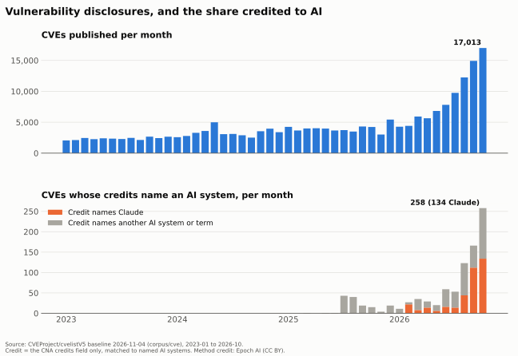

## Bottom line

**DRAFT.** Edition v0 of the paper (`docs/anthropic-contrapunctus.md` at `1afb042`) rests on Anthropic's own filings. Its argument:

> Anthropic's charter is legally real and **legally toothless**.

Its basis: “§365(b) gives directors **no duty to any person on account of a public-benefit interest**”. The public the charter names cannot enforce it.

This report looks outward at public data. It shows attention and counts only, no effect of Anthropic on any outcome. Every model-labelled number below is a witness proposal under risk codebook **v0.2-draft** (DRAFT: wording awaits review), and there is no gold set yet, so witness precision is unmeasured.

## Decision-relevant facts

Each row is a claim in the claims index. Its Evidence line names the table, the numerator and the denominator of every number.

| Fact | Evidence status / as of | Source | Implication | Claim |
| --- | --- | --- | --- | --- |
| AI framed as a risk on 12.2% of 2026 S&P 500 earnings calls (to 2026-11-04), against at most 0.6% in any year before 2023 | Calculation reproduced by the build; witness proposal; human review pending; as of 2026-11-04 | S001, S002, S003 | The call rate rises with AI talk itself (next row) | C0001 |
| AI passages per call: 0.5 in 2022, 7.7 in 2026; share framed as a risk: 0.6% to 2.7% | Calculation reproduced; witness proposal; human review pending | S001, S002, S003 | Separates framing from volume | C0002 |
| Company speakers at 79 firms raised AI as a risk in the 12 months to 2026-11-04; most named: Cybersecurity (20), Overspending / capex return (14), Safety / ethics / misuse (14) | Calculation reproduced; witness proposal; speaker role is a name heuristic | S001, S002, S003 | Analysts' questions are excluded | C0003 |
| Analysts' AI questions: 32.2% on how AI sells or what it costs, 5.7% on how its risks are governed | Calculation reproduced; witness proposal; question codebook v0.1 | S004, S005 | Analysts ask how AI sells far more than how its risks are governed | C0004 |
| Safety and ethics: 10% of executives' AI-risk passages, 39% on Hacker News about Anthropic, 61% on Wikipedia | Calculation reproduced; witness proposal; sources cover different windows | S006 | Levels compare only in rough order | C0005 |
| CVE credits name Claude on 370 CVEs and any AI system on 924 (2020-01 to 2026-10) | Calculation reproduced from the credits field; no model | S007 | Cannot confirm or refute the paper's claim of “**>33,000** critical- and high-severity flaws” | C0007 |

## What could change the conclusion

- **No gold set yet.** Witness precision is unmeasured. Gold labels come from people (`scripts/ec_gold.py`); until they exist, every model-labelled rate here is a proposal.
- **Draft codebook.** Wording of v0.2-draft awaits human review. Revised wording means rescoring and a new edition.
- **Survivorship.** The earnings-call universe is today's S&P 500.
- **Cross-source levels.** The sources cover different windows (calls dated after 2025-11-04 through 2026-11-04; HN comments dated 2025-09-01 to 2026-08-31; Wikipedia article revisions as of 2026-11-04), and their levels compare only in rough order.
- **CVE credits.** Not every flaw becomes a CVE, and credits need not name the tool. Edition v0 of the paper itself marks its claim of “**>33,000** critical- and high-severity flaws” UNVERIFIED/MED.

## Analysis

### AI framed as a risk on earnings calls

AI framed as a risk: 12.2% of 2026 S&P 500 calls (to 2026-11-04), against at most 0.6% in any year before 2023. {{C0001}} The call rate rises with AI talk itself: AI passages per call went from 0.5 in 2022 to 7.7 in 2026, while the share of AI passages framed as a risk went from 0.6% to 2.7%. {{C0002}}

### Which risks company speakers raise

Company executives and other company speakers at 79 firms raised AI as a risk in the 12 months to 2026-11-04; analysts' questions are excluded (speaker role is a name heuristic). Most named: Cybersecurity (20), Overspending / capex return (14), Safety / ethics / misuse (14). {{C0003}}

### What analysts ask

Analysts ask how AI sells or what it costs (32.2% of AI questions) far more than how its risks are governed (5.7%). {{C0004}} Each share counts a question once, however many topics in its group it carries. Question-intent codebook v0.1.

### Who talks about which AI risks

The sources cover different windows (calls dated after 2025-11-04 through 2026-11-04; HN comments dated 2025-09-01 to 2026-08-31; Wikipedia article revisions as of 2026-11-04), and their levels compare only in rough order. Safety and ethics: 10% of executives' AI-risk passages, 39% on Hacker News about Anthropic, 61% on Wikipedia. {{C0005}} HN's AI-security set is selected on security terms, so its cybersecurity share (85%) is high by construction. {{C0006}}

### CVE credits that name an AI system

CVE credits name Claude on 370 CVEs and any AI system on 924 (2020-01 to 2026-10). {{C0007}} That cannot confirm or refute the claim of “**>33,000** critical- and high-severity flaws”, which edition v0 of the paper itself marks UNVERIFIED/MED: not every flaw becomes a CVE, and credits need not name the tool. {{C0008}}

## Methods and limitations

- **Witnesses.** Model labels come from two NLI witnesses, DeBERTa and ModernBERT; a label counts only when both score it ≥ 0.5. Labels are proposals, not hand-verified findings (`docs/bert-enrichment-spec.md`).
- **Codebooks.** One risk codebook, v0.2-draft, for every model-labelled number and chart; question-intent codebook v0.1 for analysts' questions.
- **Inputs.** Every table is a step in `dag.yml`, and the build refuses to run unless every step is `ok` by content hash. Each source in the Sources index names its step.
- **Rounding.** Every number is computed from integer counts and rounded half up from the exact fraction (`scripts/display.py`). Each claim's Evidence line gives the numerator and denominator.
- **Speaker role.** Firm counts use company speakers only; the role is a name heuristic.
- **Survivorship.** The earnings-call universe is today's S&P 500.
- **No news-attention chart.** GDELT's daily series omits days, so it is not used.
- **Rebuild.** `uv run scripts/build_edition.py --codebook v0.2-draft` writes this file, its charts and `edition/STAMP.json` from source commit `dcb88bfb4dc7`; `--check` confirms a rebuild changes nothing. The PDF is rendered by the Praxis report writer (`docs/report-build.md`).

## Claims index

### C0001 — AI framed as a risk on 12.2% of 2026 S&P 500 earnings calls, against at most 0.6% in any year before 2023

- Kind: observation (witness proposal).
- Evidence: 12.2% = `ec_nli_2026`: 214 / 1,760; 2026: calls with an ai_risk window (both witnesses) / calls (S001, S002, S003); 0.6% = `ec_nli_2017`: 10 / 1,784; 2017: calls with an ai_risk window (both witnesses) / calls (S001, S002, S003).
- Check: calculation reproduced by the build from source commit `dcb88bfb4dc7`; witness precision unmeasured (no gold set).
- Human support review: pending.
- Occurrences: decision-relevant facts; analysis.

### C0002 — AI passages per call went from 0.5 in 2022 to 7.7 in 2026; the share framed as a risk went from 0.6% to 2.7%

- Kind: observation (witness proposal).
- Evidence: 0.5 = `ec_wpc_2022`: 1,018 / 1,894; 2022: AI windows / calls (S001, S002, S003); 7.7 = `ec_wpc_2026`: 13,471 / 1,760; 2026: AI windows / calls (S001, S002, S003); 0.6% = `ec_win_2022`: 6 / 1,018; 2022: AI windows flagged ai_risk (both witnesses) / AI windows (S001, S002, S003); 2.7% = `ec_win_2026`: 365 / 13,471; 2026: AI windows flagged ai_risk (both witnesses) / AI windows (S001, S002, S003).
- Check: calculation reproduced by the build from source commit `dcb88bfb4dc7`; witness precision unmeasured (no gold set).
- Human support review: pending.
- Occurrences: decision-relevant facts; analysis.

### C0003 — Company speakers at 79 firms raised AI as a risk in the 12 months to 2026-11-04; most named: Cybersecurity (20), Overspending / capex return (14), Safety / ethics / misuse (14)

- Kind: observation (witness proposal; speaker role is a name heuristic).
- Evidence: 79 = `ec_ttm_risk_firms`: firms with >= 1 company-speaker ai_risk window, trailing window (S001, S002, S003); 14 = `ec_rank_capex`: firms with a company-speaker window both ai_risk and capex, trailing window (S001, S002, S003); 20 = `ec_rank_cyber`: firms with a company-speaker window both ai_risk and cyber, trailing window (S001, S002, S003); 14 = `ec_rank_safety_ethics`: firms with a company-speaker window both ai_risk and safety_ethics, trailing window (S001, S002, S003).
- Check: calculation reproduced by the build from source commit `dcb88bfb4dc7`; witness precision unmeasured (no gold set).
- Human support review: pending.
- Occurrences: decision-relevant facts; analysis.

### C0004 — Analysts' AI questions: 32.2% on how AI sells or what it costs, 5.7% on how its risks are governed

- Kind: observation (witness proposal).
- Evidence: 32.2% = `q_commercial_pct`: 529 / 1,645; questions with any commercial intent ('q_efficiency', 'q_revenue', 'q_spend') / q_n (S004, S005); 5.7% = `q_oversight_pct`: 94 / 1,645; questions with any oversight intent ('q_controls', 'q_harm', 'q_regulation', 'q_risk', 'q_security') / q_n (S004, S005).
- Check: calculation reproduced by the build from source commit `dcb88bfb4dc7`; witness precision unmeasured (no gold set).
- Human support review: pending.
- Occurrences: decision-relevant facts; analysis.

### C0005 — Safety and ethics: 10% of executives' AI-risk passages, 39% on Hacker News about Anthropic, 61% on Wikipedia

- Kind: observation (witness proposal; levels compare across sources only in rough order).
- Evidence: 10% = `ds_executives_safety_ethics`: 18 / 179; executives: safety_ethics / AI-risk units (S006); 39% = `ds_hn_anthropic_safety_ethics`: 2,466 / 6,282; hn_anthropic: safety_ethics / AI-risk units (S006); 61% = `ds_wikipedia_safety_ethics`: 504 / 833; wikipedia: safety_ethics / AI-risk units (S006).
- Check: calculation reproduced by the build from source commit `dcb88bfb4dc7`; witness precision unmeasured (no gold set).
- Human support review: pending.
- Occurrences: decision-relevant facts; analysis.

### C0006 — Cybersecurity is 85% of HN's AI-security passages, high by construction

- Kind: observation (witness proposal; the set is selected on security terms).
- Evidence: 85% = `ds_hn_security_cyber`: 2,640 / 3,097; hn_security: cyber / AI-risk units (S006).
- Check: calculation reproduced by the build from source commit `dcb88bfb4dc7`; witness precision unmeasured (no gold set).
- Human support review: pending.
- Occurrences: analysis.

### C0007 — CVE credits name Claude on 370 CVEs and any AI system on 924 (2020-01 to 2026-10)

- Kind: observation (credits field matched to named AI systems; no model).
- Evidence: 370 = `cve_claude_total`: sum n_credit_claude, all months (S007); 924 = `cve_ai_total`: sum n_ai_credited, all months (S007).
- Check: calculation reproduced by the build from source commit `dcb88bfb4dc7`.
- Human support review: pending.
- Occurrences: decision-relevant facts; analysis.

### C0008 — Edition v0 of the paper marks its claim of “**>33,000** critical- and high-severity flaws” UNVERIFIED/MED

- Kind: observation (about the paper's own claims table).
- Evidence: **>33,000** critical- and high-severity flaws = `q_33k`: verbatim quote (emphasis and line breaks removed) (S008); UNVERIFIED/MED = `q_33k_status`: status column of the claims-table row quoting q_33k (S008).
- Check: quote matched verbatim against `1afb042` by the build.
- Human support review: pending.
- Occurrences: what could change the conclusion; analysis.

### Paper claims, verbatim at `1afb042`

Each line is an excerpt of edition v0 of the paper at `1afb042`, re-sliced and re-hashed by the build; the bold part, where one is marked, is the most relevant. Its status is the paper's own, and every figure in it is the paper's, never recomputed. Appendix C verdicts are inferences; the governance table holds recommendations; the falsifiers come from the pillar sections and the closing standing section. The paper gives recommendations and falsifiers no status. Human support review: pending for all.

- **C0009** (inference; `v0:AppC-1`): "**Designed new protein binders… success rate well above industry standard**" Paper status: NUANCED/HIGH. Excerpt `#char=74360,74433`.
- **C0010** (inference; `v0:AppC-2`): "**>33,000 critical- and high-severity flaws**" (129,000 total program) Paper status: UNVERIFIED/MED. Excerpt `#char=74548,74615`.
- **C0011** (inference; `v0:AppC-3`): Ebola sitrep "**under an hour instead of up to a full day**" Paper status: UNVERIFIED/LOW (outcome). Excerpt `#char=74786,74842`.
- **C0012** (inference; `v0:AppC-4`): Dashboards "**flagged a spike of 25,000 pneumonia cases**" Paper status: UNVERIFIED/LOW (outcome). Excerpt `#char=74968,75022`.
- **C0013** (inference; `v0:AppC-5`): "**Claude estimates 80% task-time cut**" (research) Paper status: MISLEADING as economy claim. Excerpt `#char=75101,75148`.
- **C0014** (inference; `v0:AppC-6`): "**11.4M accounts banned H1 2026**" Paper status: CONFIRMED as self-report. Excerpt `#char=75266,75297`.
- **C0015** (inference; `v0:AppC-7`): "**81,000 users in 159 countries**" want time back Paper status: CONFIRMED as survey-of-users. Excerpt `#char=75409,75455`.
- **C0016** (inference; `v0:AppC-8`): "**No universal jailbreak**" (Opus 5.5 cyber) Paper status: NUANCED. Excerpt `#char=75563,75604`.
- **C0017** (inference; `v0:AppC-9`): "**First complete computer-checked proof of Fermat's Last Theorem**" Paper status: UNVERIFIED here. Excerpt `#char=75690,75754`.
- **C0018** (inference; `v0:AppC-10`): "**~20% of shares toward public good**" Paper status: UNVERIFIED (hope). Excerpt `#char=75853,75888`.
- **C0019** (inference; `v0:AppC-11`): "**$895.4B commitments**" (S-1) Paper status: CONFIRMED/HIGH, NUANCED. Excerpt `#char=76012,76039`.
- **C0020** (inference; `v0:AppC-12`): “Revenue $41M→$386M→$4,585M (2023–25 audited); $33,242M 9M-2026; Q3-26 $16,956M” Paper status: CONFIRMED/HIGH. Excerpt `#char=76167,76245`.
- **C0021** (recommendation; `GOV-1`): “**Doubt-first replication gate** — no capability/safety/productivity claim ships until an accredited external evaluator reproduces it” Paper status: none stated. Excerpt `#char=58214,58347`.
- **C0022** (recommendation; `GOV-2`): “**Existence ≠ entailment registry** — every benefit claim filed as (quote/source exists) vs (outcome entailed, measured)” Paper status: none stated. Excerpt `#char=58549,58669`.
- **C0023** (recommendation; `GOV-3`): “**Circle labelling** — public claims tagged circle 0 artifact → 4 human attestation, with per-stage loss” Paper status: none stated. Excerpt `#char=58890,58994`.
- **C0024** (recommendation; `GOV-4`): “**Contest standing (`against`)** — cure §365/367 by charter: purpose-trust enforcer + affected-person/class contest with equal visibility” Paper status: none stated. Excerpt `#char=59165,59302`.
- **C0025** (recommendation; `GOV-5`): “**Frameworks-as-data** — ≥3 external evaluation frameworks rate the same evidence; divergence published” Paper status: none stated. Excerpt `#char=59487,59590`.
- **C0026** (recommendation; `GOV-6`): “**Exit with proof** — rights-holder/user deletion incl. model-effect exit, tested for residual memorization” Paper status: none stated. Excerpt `#char=59737,59844`.
- **C0027** (recommendation; `GOV-7`): “**No-training provenance ledger** — hash-chained training-corpus ledger; binding no-train on contested/customer data” Paper status: none stated. Excerpt `#char=60023,60139`.
- **C0028** (recommendation; `GOV-8`): “**Irrevocable mission lock** — move Class T economics+votes (or a golden veto on purpose/sale/model-transfer) to a purpose trust with an enforcer; delete sunset/redemption and supermajority trustee-removal” Paper status: none stated. Excerpt `#char=60290,60495`.
- **C0029** (recommendation; `GOV-9`): “**Misuse-revenue disgorgement** — audit the disclosed 5–7% quarterly” Paper status: none stated. Excerpt `#char=60659,60727`.
- **C0030** (recommendation; `GOV-10`): “**Incident + externality bond** — mandatory timed disclosure of eval-escape class incidents; metered power/water/displacement per site vs bond” Paper status: none stated. Excerpt `#char=60925,61067`.
- **C0031** (falsifier; `v0:Pillar-1-falsifier`): “A pre-registered evaluation suite, run by an evaluator Anthropic does not select-per-engagement, with published pass/fail thresholds that have actually stopped or delayed a launch — once.” Paper status: none stated. Excerpt `#char=49684,49871`.
- **C0032** (falsifier; `v0:Pillar-2-falsifier`): “A signed embedded-evaluator contract with blockade (not advisory) rights and published divergence reports.” Paper status: none stated. Excerpt `#char=51350,51456`.
- **C0033** (falsifier; `v0:Pillar-3-falsifier`): “GOV-8 executed; or a public register of national-security use categories with an external reviewer cleared to see the rest.” Paper status: none stated. Excerpt `#char=53125,53248`.
- **C0034** (falsifier; `v0:Pillar-4-falsifier`): “Cohort-level employment/earnings outcomes for Corps fellows and benefits-access households at 12/24 months, third-party evaluated, with the same treatment for a measured harmed cohort.” Paper status: none stated. Excerpt `#char=55207,55391`.
- **C0035** (falsifier; `v0:Pillar-5-falsifier`): “Partner-published outcome evaluations (mortality, learning gains, time-to-diagnosis) and data-governance terms for each flagship deployment, in the partners' names.” Paper status: none stated. Excerpt `#char=57399,57563`.
- **C0036** (falsifier; `v0:Falsifier-1`): “CVE-level, deduplicated, externally attested security-benefit counts” Paper status: none stated. Excerpt `#char=66434,66502`.
- **C0037** (falsifier; `v0:Falsifier-2`): “outcome (not dashboard) evaluations from IRC/WHO-class partners” Paper status: none stated. Excerpt `#char=66508,66571`.
- **C0038** (falsifier; `v0:Falsifier-3`): “an audited corpus-provenance percentage with an operating rights-holder exit” Paper status: none stated. Excerpt `#char=66577,66653`.
- **C0039** (falsifier; `v0:Falsifier-4`): “quarterly misuse-revenue dollars trending under 1% with victim counts” Paper status: none stated. Excerpt `#char=66659,66728`.
- **C0040** (falsifier; `v0:Falsifier-5`): “an irrevocable charter amendment implementing GOV-8” Paper status: none stated. Excerpt `#char=66734,66785`.
- **C0041** (falsifier; `v0:Falsifier-6`): “metered site footprints” Paper status: none stated. Excerpt `#char=66794,66817`.

## Sources index

### S001 — `corpus/earnings-calls/calls.tsv`

Written by step `data://meadow/earnings_calls/2026-11-04/ai_windows` (metadata `corpus/earnings-calls/ai_windows.meta.yml`). BLAKE3 `5f74c37cce10819c413118902cb7cd2b5d40c55a7fb771201a3aeb0601cf9bfb`. Licence, attribution and refresh commands: `DATASETS.md`. Cited by C0001, C0002, C0003.

### S002 — `corpus/earnings-calls/ai-windows.parquet`

Written by step `data://meadow/earnings_calls/2026-11-04/ai_windows` (metadata `corpus/earnings-calls/ai_windows.meta.yml`). BLAKE3 `f0d0b95a92ed6edf2be3eadbb701229f3802d27ec7a634774b004cf86a433057`. Licence, attribution and refresh commands: `DATASETS.md`. Cited by C0001, C0002, C0003.

### S003 — `proposals/earnings-calls/codebook-v0.2-draft`

Written by step `data://witness/earnings_calls/2026-11-04/codebook_v0_2_draft` (metadata `proposals/earnings-calls/codebook-v0.2-draft/codebook_v0_2_draft.meta.yml`). A directory of witness scores; each file is locked by hash in `dag.lock.tsv`. Licence, attribution and refresh commands: `DATASETS.md`. Cited by C0001, C0002, C0003.

### S004 — `corpus/earnings-calls/ai-questions.parquet`

Written by step `data://meadow/earnings_calls/2026-11-04/ai_questions` (metadata `corpus/earnings-calls/ai_questions.meta.yml`). BLAKE3 `ee5cb96bce7e2f868ec1e3843fd8e80a72123590faf7e07fd5b26694283d1d46`. Licence, attribution and refresh commands: `DATASETS.md`. Cited by C0004.

### S005 — `proposals/earnings-calls/codebook-questions-v0.1`

Written by step `data://witness/earnings_calls/2026-11-04/codebook_questions_v0_1` (metadata `proposals/earnings-calls/codebook-questions-v0.1/codebook_questions_v0_1.meta.yml`). Written by step `data://witness/earnings_calls/2026-11-04/question_report` (metadata `proposals/earnings-calls/codebook-questions-v0.1/report/question_report.meta.yml`). A directory of witness scores; each file is locked by hash in `dag.lock.tsv`. Licence, attribution and refresh commands: `DATASETS.md`. Cited by C0004.

### S006 — `proposals/cross-source/codebook-v0.2-draft/report/dialogue-space.tsv`

Written by step `data://witness/cross_source/2026-11-04/dialogue_space_v0_2_draft` (metadata `proposals/cross-source/codebook-v0.2-draft/report/dialogue_space_v0_2_draft.meta.yml`). BLAKE3 `a2d5869a99a34a667d6a45fccbd60291d0aa8a10e5688f8be71f34f2c852d291`. Licence, attribution and refresh commands: `DATASETS.md`. Cited by C0005, C0006.

### S007 — `corpus/cve/monthly-ai.tsv`

Written by step `data://garden/cve/2026-11-04/monthly_series` (metadata `corpus/cve/monthly_series.meta.yml`). BLAKE3 `fe11744debe42411f7b9f491634c98e176feae699b6710fbd856bf311ee48caf`. Licence, attribution and refresh commands: `DATASETS.md`. Cited by C0007.

### S008 — `docs/anthropic-contrapunctus.md@1afb042`

Edition v0 of the paper, `docs/anthropic-contrapunctus.md` at commit `1afb042`, hand-written and frozen. Quotes are matched verbatim against this commit by the build. Cited by C0008.

## Revision and review record

- **Status.** DRAFT working paper; no claim has had human support review. The build stamp, `edition/STAMP.json`, is unsigned: a person signs it, agents never do.
- **This edition.** Generated by `scripts/build_edition.py --codebook v0.2-draft` from source commit `dcb88bfb4dc7a37b46816ce6a6a9bd7887a48b54`. Edit `edition/report.template.md`, not this file.
- **Change from the previous build.** The Marp deck is retired; this report is the edition's only source, with the same findings and the same bindings.
- **Frozen.** Edition v0 of the paper stays as written at `1afb042`.
