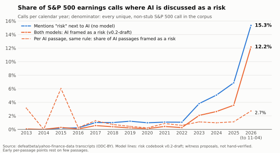
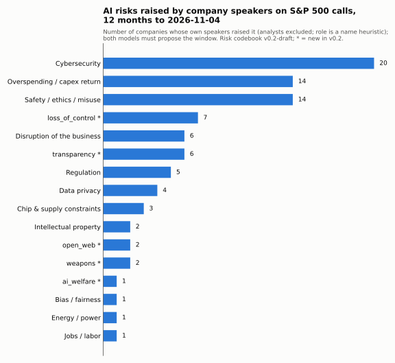
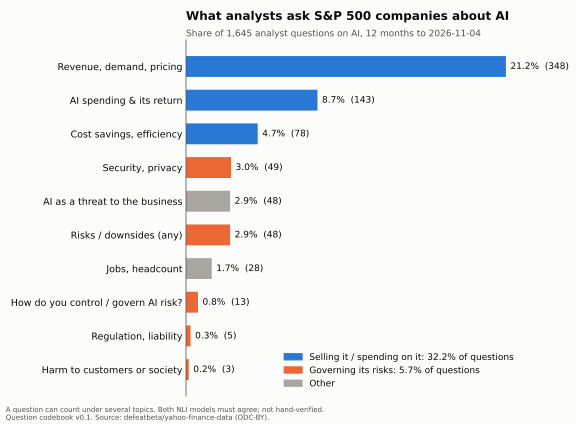
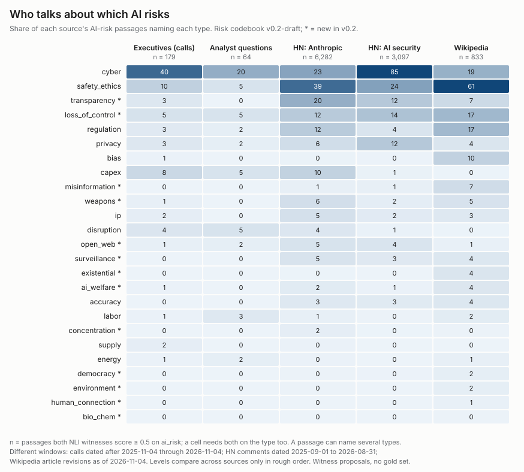
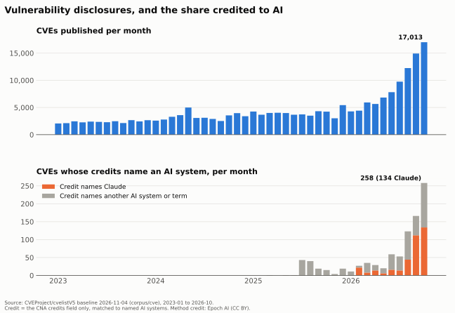

## Bottom line

**DRAFT.** Edition {{paper_edition}} of the paper (`docs/anthropic-contrapunctus.md` at `{{paper_v0}}`) rests on Anthropic's own filings. Its argument:

> {{q_toothless}}

Its basis: “{{q_365b}}”. The public the charter names cannot enforce it.

This report looks outward at public data. It shows attention and counts only, no effect of Anthropic on any outcome. Every model-labelled number below is a witness proposal under risk codebook **{{codebook}}**{{codebook_status}}, and there is no gold set yet, so witness precision is unmeasured.

## Decision-relevant facts

Each row is a claim in the claims index. Its Evidence line names the table, the numerator and the denominator of every number.

| Fact | Evidence status / as of | Source | Implication | Claim |
| --- | --- | --- | --- | --- |
| AI framed as a risk on {{ec_pct_witness_last}}% of {{ec_year_last}} S&P 500 earnings calls (to {{as_of}}), against at most {{ec_pre2023_max}}% in any year before {{ec_cutoff_year}} | Calculation reproduced by the build; witness proposal; human review pending; as of {{as_of}} | {{src_ec_rise}} | The call rate rises with AI talk itself (next row) | {{c_ec_rise}} |
| AI passages per call: {{ec_wpc_base}} in {{ec_win_base_year}}, {{ec_wpc_last}} in {{ec_year_last}}; share framed as a risk: {{ec_win_base}}% to {{ec_win_last}}% | Calculation reproduced; witness proposal; human review pending | {{src_ec_volume}} | Separates framing from volume | {{c_ec_volume}} |
| Company speakers at {{ec_ttm_risk_firms}} firms raised AI as a risk in the {{ttm_months}} months to {{as_of}}; most named: {{ec_top3}} | Calculation reproduced; witness proposal; speaker role is a name heuristic | {{src_ec_firms}} | Analysts' questions are excluded | {{c_ec_firms}} |
| Analysts' AI questions: {{q_commercial_pct}}% on how AI sells or what it costs, {{q_oversight_pct}}% on how its risks are governed | Calculation reproduced; witness proposal; question codebook {{question_codebook}} | {{src_q_intent}} | Analysts ask how AI sells far more than how its risks are governed | {{c_q_intent}} |
| Safety and ethics: {{ds_exec_safety}}% of executives' AI-risk passages, {{ds_hn_safety}}% on Hacker News about Anthropic, {{ds_wp_safety}}% on Wikipedia | Calculation reproduced; witness proposal; sources cover different windows | {{src_ds_safety}} | Levels compare only in rough order | {{c_ds_safety}} |
| CVE credits name Claude on {{cve_claude_total}} CVEs and any AI system on {{cve_ai_total}} ({{cve_first}} to {{cve_last}}) | Calculation reproduced from the credits field; no model | {{src_cve_credit}} | Cannot confirm or refute the paper's claim of “{{q_33k}}” | {{c_cve_credit}} |

## What could change the conclusion

- **No gold set yet.** Witness precision is unmeasured. Gold labels come from people (`scripts/ec_gold.py`); until they exist, every model-labelled rate here is a proposal.
- **Draft codebook.** Wording of {{codebook}} awaits human review. Revised wording means rescoring and a new edition.
- **Survivorship.** The earnings-call universe is today's S&P 500.
- **Cross-source levels.** The sources cover different windows ({{ds_window_calls}}; HN {{ds_window_hn}}; Wikipedia {{ds_window_wikipedia}}), and their levels compare only in rough order.
- **CVE credits.** Not every flaw becomes a CVE, and credits need not name the tool. Edition {{paper_edition}} of the paper itself marks its claim of “{{q_33k}}” {{q_33k_status}}.

## Analysis

### AI framed as a risk on earnings calls

AI framed as a risk: {{ec_pct_witness_last}}% of {{ec_year_last}} S&P 500 calls (to {{as_of}}), against at most {{ec_pre2023_max}}% in any year before {{ec_cutoff_year}}. {{ct_ec_rise}} The call rate rises with AI talk itself: AI passages per call went from {{ec_wpc_base}} in {{ec_win_base_year}} to {{ec_wpc_last}} in {{ec_year_last}}, while the share of AI passages framed as a risk went from {{ec_win_base}}% to {{ec_win_last}}%. {{ct_ec_volume}}

### Which risks company speakers raise

Company executives and other company speakers at {{ec_ttm_risk_firms}} firms raised AI as a risk in the {{ttm_months}} months to {{as_of}}; analysts' questions are excluded (speaker role is a name heuristic). Most named: {{ec_top3}}. {{ct_ec_firms}}

### What analysts ask

Analysts ask how AI sells or what it costs ({{q_commercial_pct}}% of AI questions) far more than how its risks are governed ({{q_oversight_pct}}%). {{ct_q_intent}} Each share counts a question once, however many topics in its group it carries. Question-intent codebook {{question_codebook}}.

### Who talks about which AI risks

The sources cover different windows ({{ds_window_calls}}; HN {{ds_window_hn}}; Wikipedia {{ds_window_wikipedia}}), and their levels compare only in rough order. Safety and ethics: {{ds_exec_safety}}% of executives' AI-risk passages, {{ds_hn_safety}}% on Hacker News about Anthropic, {{ds_wp_safety}}% on Wikipedia. {{ct_ds_safety}} HN's AI-security set is selected on security terms, so its cybersecurity share ({{ds_sec_cyber}}%) is high by construction. {{ct_ds_cyber}}

### CVE credits that name an AI system

CVE credits name Claude on {{cve_claude_total}} CVEs and any AI system on {{cve_ai_total}} ({{cve_first}} to {{cve_last}}). {{ct_cve_credit}} That cannot confirm or refute the claim of “{{q_33k}}”, which edition {{paper_edition}} of the paper itself marks {{q_33k_status}}: not every flaw becomes a CVE, and credits need not name the tool. {{ct_paper_33k}}

## Methods and limitations

- **Witnesses.** Model labels come from two NLI witnesses, DeBERTa and ModernBERT; a label counts only when both score it ≥ {{threshold}}. Labels are proposals, not hand-verified findings (`docs/bert-enrichment-spec.md`).
- **Codebooks.** One risk codebook, {{codebook}}, for every model-labelled number and chart; question-intent codebook {{question_codebook}} for analysts' questions.
- **Inputs.** Every table is a step in `dag.yml`, and the build refuses to run unless every step is `ok` by content hash. Each source in the Sources index names its step.
- **Rounding.** Every number is computed from integer counts and rounded half up from the exact fraction (`scripts/display.py`). Each claim's Evidence line gives the numerator and denominator.
- **Speaker role.** Firm counts use company speakers only; the role is a name heuristic.
- **Survivorship.** The earnings-call universe is today's S&P 500.
- **No news-attention chart.** GDELT's daily series omits days, so it is not used.
- **Rebuild.** `uv run scripts/build_edition.py --codebook {{codebook}}` writes this file, its charts and `edition/STAMP.json` from source commit `{{source_commit}}`; `--check` confirms a rebuild changes nothing. The PDF is rendered by the Praxis report writer (`docs/report-build.md`).

## Claims index

### {{c_ec_rise}} — AI framed as a risk on {{ec_pct_witness_last}}% of {{ec_year_last}} S&P 500 earnings calls, against at most {{ec_pre2023_max}}% in any year before {{ec_cutoff_year}}

- Kind: observation (witness proposal).
- Evidence: {{ev_ec_rise}}
- Check: calculation reproduced by the build from source commit `{{source_commit}}`; witness precision unmeasured (no gold set).
- Human support review: pending.
- Occurrences: decision-relevant facts; analysis.

### {{c_ec_volume}} — AI passages per call went from {{ec_wpc_base}} in {{ec_win_base_year}} to {{ec_wpc_last}} in {{ec_year_last}}; the share framed as a risk went from {{ec_win_base}}% to {{ec_win_last}}%

- Kind: observation (witness proposal).
- Evidence: {{ev_ec_volume}}
- Check: calculation reproduced by the build from source commit `{{source_commit}}`; witness precision unmeasured (no gold set).
- Human support review: pending.
- Occurrences: decision-relevant facts; analysis.

### {{c_ec_firms}} — Company speakers at {{ec_ttm_risk_firms}} firms raised AI as a risk in the {{ttm_months}} months to {{as_of}}; most named: {{ec_top3}}

- Kind: observation (witness proposal; speaker role is a name heuristic).
- Evidence: {{ev_ec_firms}}
- Check: calculation reproduced by the build from source commit `{{source_commit}}`; witness precision unmeasured (no gold set).
- Human support review: pending.
- Occurrences: decision-relevant facts; analysis.

### {{c_q_intent}} — Analysts' AI questions: {{q_commercial_pct}}% on how AI sells or what it costs, {{q_oversight_pct}}% on how its risks are governed

- Kind: observation (witness proposal).
- Evidence: {{ev_q_intent}}
- Check: calculation reproduced by the build from source commit `{{source_commit}}`; witness precision unmeasured (no gold set).
- Human support review: pending.
- Occurrences: decision-relevant facts; analysis.

### {{c_ds_safety}} — Safety and ethics: {{ds_exec_safety}}% of executives' AI-risk passages, {{ds_hn_safety}}% on Hacker News about Anthropic, {{ds_wp_safety}}% on Wikipedia

- Kind: observation (witness proposal; levels compare across sources only in rough order).
- Evidence: {{ev_ds_safety}}
- Check: calculation reproduced by the build from source commit `{{source_commit}}`; witness precision unmeasured (no gold set).
- Human support review: pending.
- Occurrences: decision-relevant facts; analysis.

### {{c_ds_cyber}} — Cybersecurity is {{ds_sec_cyber}}% of HN's AI-security passages, high by construction

- Kind: observation (witness proposal; the set is selected on security terms).
- Evidence: {{ev_ds_cyber}}
- Check: calculation reproduced by the build from source commit `{{source_commit}}`; witness precision unmeasured (no gold set).
- Human support review: pending.
- Occurrences: analysis.

### {{c_cve_credit}} — CVE credits name Claude on {{cve_claude_total}} CVEs and any AI system on {{cve_ai_total}} ({{cve_first}} to {{cve_last}})

- Kind: observation (credits field matched to named AI systems; no model).
- Evidence: {{ev_cve_credit}}
- Check: calculation reproduced by the build from source commit `{{source_commit}}`.
- Human support review: pending.
- Occurrences: decision-relevant facts; analysis.

### {{c_paper_33k}} — Edition {{paper_edition}} of the paper marks its claim of “{{q_33k}}” {{q_33k_status}}

- Kind: observation (about the paper's own claims table).
- Evidence: {{ev_paper_33k}}
- Check: quote matched verbatim against `{{paper_v0}}` by the build.
- Human support review: pending.
- Occurrences: what could change the conclusion; analysis.

### Paper claims, verbatim at `{{paper_v0}}`

Each line is an excerpt of edition {{paper_edition}} of the paper at `{{paper_v0}}`, re-sliced and re-hashed by the build; the bold part, where one is marked, is the most relevant. Its status is the paper's own, and every figure in it is the paper's, never recomputed. Appendix C verdicts are inferences; the governance table holds recommendations; the falsifiers come from the pillar sections and the closing standing section. The paper gives recommendations and falsifiers no status. Human support review: pending for all.

{{paper_claims_index}}

## Sources index

{{sources_index}}

## Revision and review record

- **Status.** DRAFT working paper; no claim has had human support review. The build stamp, `edition/STAMP.json`, is unsigned: a person signs it, agents never do.
- **This edition.** {{generated_notice}}
- **Change from the previous build.** The Marp deck is retired; this report is the edition's only source, with the same findings and the same bindings.
- **Frozen.** Edition {{paper_edition}} of the paper stays as written at `{{paper_v0}}`.
